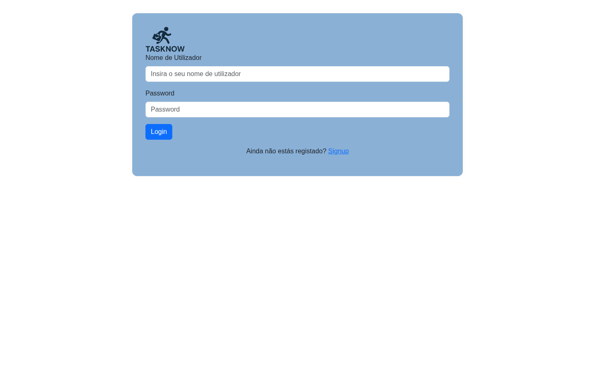
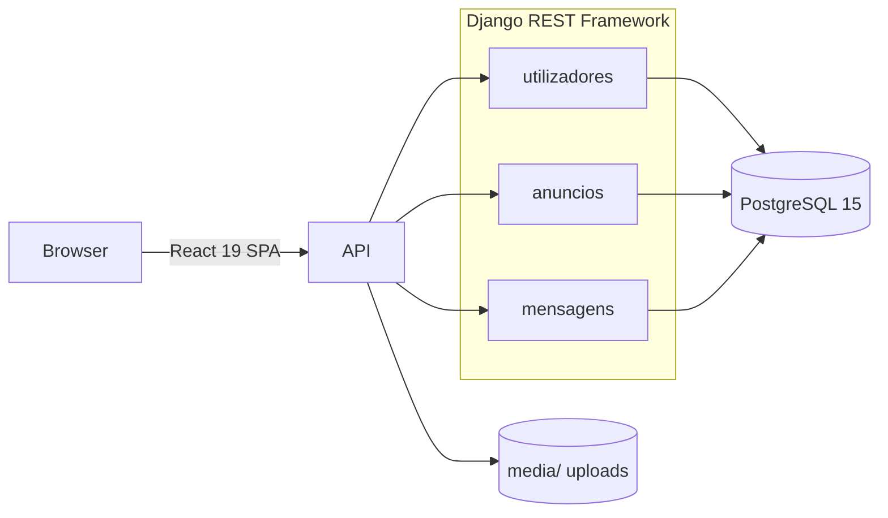

# TaskNow

[](https://github.com/tiagofsps/task-now/actions/workflows/ci.yml)


A full-stack marketplace that connects clients with service providers — a
plumber, an electrician, a carpenter. Clients search adverts by district and
service type, open a conversation with the provider, and manage their own
adverts; providers publish their services; administrators manage users, service
types and adverts.

Built with Django REST Framework and React, containerised with Docker Compose.



## About this project

This is my first web project, written in April and May 2025 while learning
Django and React from scratch. It was never a product: it exists to show how I
approach a domain I did not know, and the commit history is the original one —
including the day I was stuck on authentication errors and the one where login
finally worked.

The 2026 pass containerised it, moved it from SQLite to PostgreSQL, renamed the
frontend and added this documentation. Everything after that is ordinary
development.

## What it does

| Area | Behaviour |
|---|---|
| Search | Filter adverts by district and service type, open an advert, contact the provider |
| Accounts | Sign up, log in, log out, profile and profile picture |
| Adverts | Create, edit and delete your own advert; attach images |
| Messaging | Per-advert conversations between client and provider |
| Admin | Manage users, service types and adverts from the app; Django admin for the rest |

## Architecture



- `utilizadores/` — custom user profile on top of Django's `User`, authentication endpoints
- `anuncios/` — districts, service types, adverts and advert images
- `mensagens/` — conversations between a client and a provider
- `diam_project/` — settings, URLs and WSGI/ASGI entry points
- `frontend/` — the React application (Create React App)

Session authentication: the API uses Django sessions and CSRF, not tokens.

## Quickstart

Requires Docker and Docker Compose.

```bash
git clone git@github.com:tiagofsps/task-now.git
cd task-now
cp .env.example .env      # optional: adjust database credentials or the secret key
docker compose up --build
```

- Frontend: http://localhost:3000
- API: http://localhost:8000
- Django admin: http://localhost:8000/admin/

On first start the container applies migrations and seeds demo data
(`python manage.py seed_demo`): 18 districts, 7 service types, three accounts and
a couple of adverts. The command is idempotent, so restarts are safe.

### Run without Docker

The database is published on port 5433, so Django can run on the host while
PostgreSQL stays in a container.

```bash
# 1. Database only
docker compose up -d db

# 2. Python environment
python3 -m venv .venv
source .venv/bin/activate
pip install -r requirements.txt

# 3. Point Django at the published port and prepare the database
export POSTGRES_HOST=127.0.0.1 POSTGRES_PORT=5433
python manage.py migrate
python manage.py seed_demo

# 4. Run the API
python manage.py runserver 8000
```

Then the frontend, in a second terminal:

```bash
cd frontend
npm install
npm start          # http://localhost:3000
```

Django reads these settings from the environment, not from `.env`; export the
variables or set them in your shell profile.

### Demo accounts

| Account | Username | Password |
|---|---|---|
| Client | `cliente_demo` | `Password123!` |
| Provider | `prestador_demo` | `Password123!` |
| Admin | `admin_demo` | `Password123!` |

## Configuration

All settings come from the environment; `.env.example` documents each variable.

| Variable | Default | Purpose |
|---|---|---|
| `POSTGRES_DB` / `POSTGRES_USER` / `POSTGRES_PASSWORD` | `tasknow_db` / `tasknow_user` / `tasknow_password` | Database |
| `POSTGRES_HOST` / `POSTGRES_PORT` | `127.0.0.1` / `5432` | Database location (compose sets `db` for containers) |
| `POSTGRES_HOST_PORT` | `5433` | Host port the database container is published on |
| `DJANGO_SECRET_KEY` | development fallback | Signing key; set it for anything public |
| `DJANGO_DEBUG` | `True` | Debug mode |
| `DJANGO_ALLOWED_HOSTS` | `localhost,127.0.0.1` | Comma-separated hosts |

## Tests and CI

```bash
docker compose up -d db
python manage.py test                     # in the venv, with POSTGRES_PORT=5433
# or
docker compose run --rm backend python manage.py test
```

Nine tests cover the seeder (including idempotency), login, logout and the
public catalogue endpoints. CI runs them against a PostgreSQL service, plus
Django system checks, a migration-drift check and a production frontend build.

The frontend has no automated tests yet; that is the most obvious gap.

## Tradeoffs and what I'd do differently

- **`Anuncio.autor` is a `OneToOneField`**, so a user can own only one advert.
  It should be a `ForeignKey`; the seeder works around it.
- **The frontend calls `http://localhost:8000` directly** in several components
  instead of using a single configured base URL.
- **Create React App is unmaintained.** React 19 on `react-scripts` 5 works, but
  I would start a new project on Vite.
- **No frontend tests**, and the backend suite covers the endpoints rather than
  the full UI flows.
- **Session authentication with CSRF** is fine for a same-origin app; a separate
  frontend deployment would need CORS credentials handled carefully, or tokens.

## License

[MIT](LICENSE) © 2026 Tiago Pires.

Written as a college project and published as a portfolio piece. Use it, learn
from it, or borrow from it; contributions are not expected.
